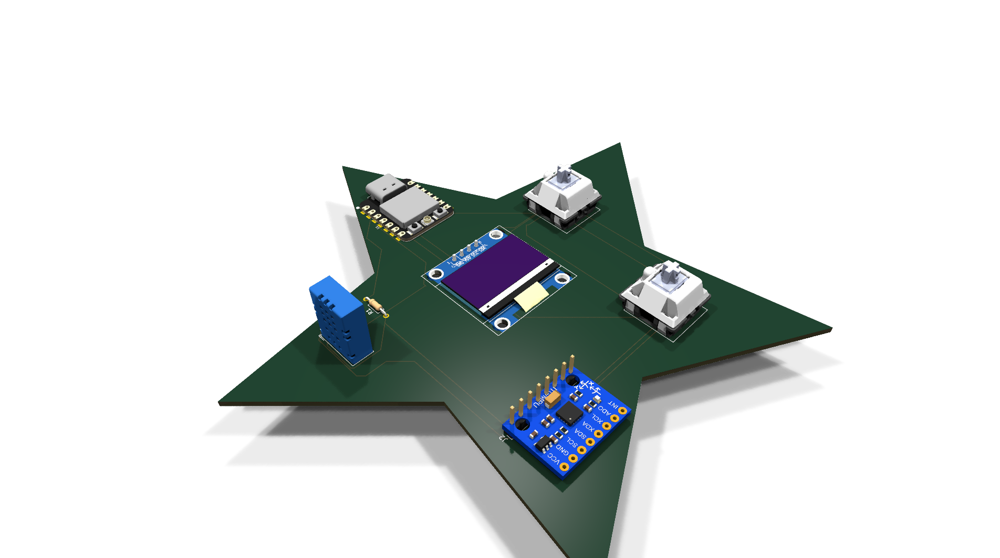
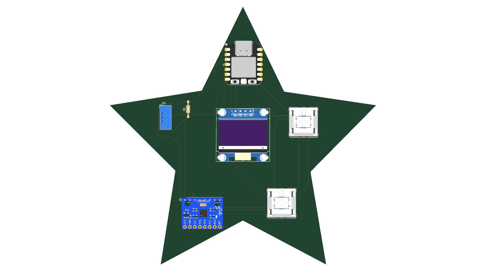
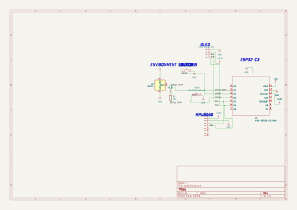
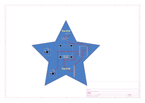

# Starbie ⭐

Starbie is a star-shaped digital pet and macropad I designed for **Hack Club Half-Life (Week 1)**!

It sits on your desk, shows a cute face on the screen, reads the room temperature and humidity, and reacts when you pick it up or tilt it. You can also use the two mechanical keyboard switches to interact with it or use them as shortcut keys.

---

## Photos & Screenshots

### 3D Render

### Top View

### Schematic

### PCB Layout

*(Photos of the real assembled board will be added here as soon as my PCBs arrive in the mail!)*

---

## How It Works

### How the parts fit on the star
I placed each part on a different point of the star to keep it balanced:
- **Center**: The 0.96" OLED display sits in the middle as Starbie's face.
- **Top point**: The DHT11 temperature & humidity sensor and its 10k resistor sit here, away from the heat of the microcontroller.
- **Right point**: The Seeed Studio XIAO ESP32-C3 microcontroller sits here with its USB-C port facing outwards so you can easily plug it in.
- **Bottom-right point**: The MPU6050 motion sensor sits here to track tilting and shaking.
- **Left and bottom-left points**: Two Cherry MX mechanical keyswitches sit here so your fingers can easily tap them.

### How they connect
- **Power**: The XIAO ESP32-C3 gets 5V from USB-C and provides 3.3V to power the OLED screen, MPU6050, and DHT11. The whole board has a ground plane on both sides.
- **I2C Bus**: The OLED display and the MPU6050 motion sensor share the same two I2C pins (`D4` for SCL and `D5` for SDA).
- **DHT11**: Sends temperature and humidity data to pin `D1` using a 10k pull-up resistor to 3.3V.
- **Switches**: The two Cherry MX switches connect to pins `D2` and `D3`. When you press a switch, it pulls the pin to GND.

---

## Wiring & Pinout

All connections are made through the PCB traces. Here is how each pin connects:

| Component | Pin | Connected To | What it does |
| :--- | :--- | :--- | :--- |
| **XIAO ESP32-C3** | 3V3 / GND | Power rails | Powers the board (3.3V) |
| **XIAO ESP32-C3** | D1 (GPIO3) | DHT11 Data | Reads temperature & humidity |
| **XIAO ESP32-C3** | D2 (GPIO4) | Switch 1 (SW1) | Button 1 (Active LOW) |
| **XIAO ESP32-C3** | D3 (GPIO5) | Switch 2 (SW2) | Button 2 (Active LOW) |
| **XIAO ESP32-C3** | D4 (GPIO6) | OLED SCL & MPU SCL | I2C Clock line |
| **XIAO ESP32-C3** | D5 (GPIO7) | OLED SDA & MPU SDA | I2C Data line |
| **0.96" OLED** | VCC / GND | 3.3V / GND | Screen power |
| **0.96" OLED** | SCL / SDA | D4 / D5 | Display graphics & face |
| **MPU6050** | VCC / GND | 3.3V / GND | Sensor power |
| **MPU6050** | SCL / SDA | D4 / D5 | Gyro & accelerometer data |
| **DHT11** | VCC / GND | 3.3V / GND | Sensor power |
| **DHT11** | Data | D1 (with 10k to 3.3V)| Temperature & humidity signal |
| **Cherry MX 1** | Pin 1 / Pin 2 | D2 / GND | Key press input 1 |
| **Cherry MX 2** | Pin 1 / Pin 2 | D3 / GND | Key press input 2 |
| **10k Resistor**| Pin 1 / Pin 2 | 3.3V / D1 | Pull-up for DHT11 data |

---

## Bill of Materials (BOM)

| Item | Qty | Supplier | Cost / Item | Total Cost | Link |
| :--- | :---: | :--- | :---: | :---: | :--- |
| **Seeed Studio XIAO ESP32-C3** | 1 | UrbanProto | $7.77 | $7.77 | [UrbanProto](https://www.urbanproto.com/part/102010636) |
| **0.96" I2C OLED Display (128x64)** | 1 | Circuitkar | $1.47 | $1.47 | [Circuitkar](https://www.circuitkar.in/products/oled-096-i2c) |
| **GY-521 MPU-6050 Motion Sensor** | 1 | ElectroPi | $2.04 | $2.04 | [ElectroPi](https://www.electropi.in/mpu6050-triple-axis-gyro-accelerometer-module?search=mpu605) |
| **DHT11 Temp & Humidity Sensor** | 1 | Robu | $0.63 | $0.63 | [Robu.in](https://robu.in/product/dht11-digital-relative-humidity-temperature-sensor-module/) |
| **Cherry MX Switches (Board Mount)** | 2 | Mouser | $0.75 | $1.50 | [Mouser](https://www.mouser.in/en/ProductDetail/540-MX2A-E1NB) |
| **10kΩ Resistors (Pack of 10)** | 10 | Robu | $0.01 | $0.10 | [Robu.in](https://robu.in/product/mf25-10k-multicomp-pro-through-hole-resistor-10-kohm-250-mw-%c2%b1-1-axial-leaded-250-v/) |
| **Estimated Shipping** | 1 | — | $0.00 | $0.00 | — |
| **Total** | | | | **$13.51** | |

---

## How to Build & Solder

1. **Solder the 10k resistor (R1)** first since it sits flat on the board.
2. **Solder the female pin headers** for the OLED screen (4 pins), MPU6050 (8 pins), and XIAO ESP32-C3 (two 7-pin rows).
3. **Solder the DHT11 sensor**.
4. **Push the two Cherry MX switches** into place and solder their two pins on the back. Put your keycaps on!
5. **Plug the modules in**: Slide the OLED, MPU6050, and XIAO into their headers.
6. **Plug in USB-C** and upload the firmware!

---

## Software & Code

The code is in the [`firmware/`](firmware/) folder.

To upload it using the Arduino IDE:
1. Install the **esp32** board package in Arduino IDE.
2. Select **Seeed Studio XIAO ESP32C3** as your board.
3. Install these libraries from Library Manager:
   - `Adafruit SSD1306`
   - `Adafruit GFX Library`
   - `Adafruit MPU6050`
   - `DHT sensor library`
4. Open [`firmware/firmware.ino`](firmware/firmware.ino) and hit **Upload**!

---

## KiCad Files

The project files can be opened in KiCad 10:
- Project file: [`pcb2/pcb2.kicad_pro`](pcb2/pcb2.kicad_pro) (also at [`week1 pratham.kicad_pro`](week1%20pratham.kicad_pro))
- Schematic: [`pcb2/pcb2.kicad_sch`](pcb2/pcb2.kicad_sch)
- PCB layout: [`pcb2/pcb2.kicad_pcb`](pcb2/pcb2.kicad_pcb)
- Gerber files: [`gerbers.zip`](gerbers.zip)
