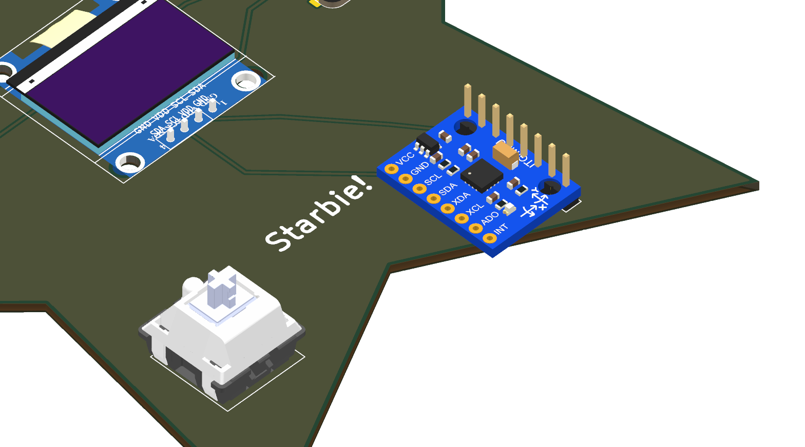
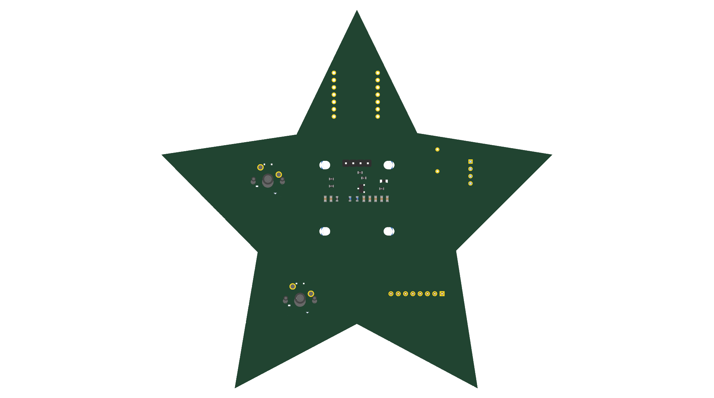

# ⚡ Half-Life: Week 1 PCB — Environmental & Motion MacroPad

[](https://hackclub.com)
[](https://kicad.org)
[](https://www.seeedstudio.com/Seeed-XIAO-ESP32C3-p-5431.html)
[](https://github.com/ez-pratham/half-life_VP)

A custom, open-source 2-layer printed circuit board designed for **Hack Club's Half-Life** hardware program (Week 1: PCB Theme). Built around the compact, high-performance **Seeed Studio XIAO ESP32-C3** microcontroller, this board pairs environmental climate telemetry, 6-axis inertial motion tracking, tactile mechanical key switches, and a crystal-clear monochrome OLED interface.

---

## 📸 Project Gallery

### 3D Isometric Board Render


### Top View & Component Placement


### Cherry MX Switches & Tactile Interface


### Bottom Copper Layer & Ground Plane


---

## 🔍 What is This Project?

The **Half-Life Week 1 PCB** is a multi-functional desktop sensor station and macro controller designed to explore embedded hardware design, PCB layout fundamentals, high-speed microcontroller integration, and sensor telemetry.

Instead of a simple LED blinker board, this design combines five distinct hardware domains onto a single compact PCB:
1. **Compute & Wireless**: Seeed Studio XIAO ESP32-C3 (32-bit RISC-V core @ 160MHz with Wi-Fi & BLE).
2. **Visual Feedback**: 0.96" SSD1306 monochrome I2C OLED display (128×64 resolution).
3. **Environmental Telemetry**: DHT11 digital humidity and temperature sensor.
4. **Inertial Measurement (IMU)**: GY-521 MPU6050 6-DoF sensor (3-axis gyroscope + 3-axis accelerometer).
5. **Physical Human-Machine Interface**: 2× Cherry MX mechanical keyboard switches with DSA keycaps.

---

## ⚙️ How It Works

### Architecture Diagram

```
+-------------------------------------------------------------+
|                     Seeed Studio XIAO                       |
|                         ESP32-C3                            |
+---------+------------------+------------------+-------------+
          |                  |                  |
    I2C Bus (SDA/SCL)   Digital (1-Wire)   Active LOW Inputs
          |                  |                  |
    +-----+-----+            |            +-----+-----+
    |           |            |            |           |
    v           v            v            v           v
+-------+   +-------+    +-------+    +-------+   +-------+
| 0.96" |   | MPU   |    | DHT11 |    | Cherry|   | Cherry|
| OLED  |   | 6050  |    | Temp/ |    | MX    |   | MX    |
| Screen|   | 6-DoF |    | Humid |    | SW 1  |   | SW 2  |
+-------+   +-------+    +-------+    +-------+   +-------+
 (0x3C)      (0x68)       (Pullup)     (Cycle)     (Action)
```

1. **Power Distribution**:
   - The board is powered via the USB-C connector on the Seeed XIAO ESP32-C3 module.
   - The onboard low-dropout (LDO) regulator outputs a clean, stable +3.3V rail powering the OLED display, DHT11, and MPU6050.
   - A solid ground plane on both front and back copper layers minimizes electromagnetic interference (EMI) and ensures clean sensor signals.

2. **I2C Communication Bus**:
   - Both the 0.96" SSD1306 OLED display (`0x3C`) and the GY-521 MPU6050 motion sensor (`0x68`) share the high-speed hardware I2C bus on pins `D4` (SDA) and `D5` (SCL).

3. **1-Wire Temperature & Humidity Acquisition**:
   - The DHT11 digital sensor uses a custom single-wire communication protocol tied to pin `D1` (GPIO3). A dedicated 10kΩ pull-up resistor (`R1`) guarantees clean signal integrity across transitions.

4. **Tactile Mechanical Switch Matrix**:
   - Switches `SW1` and `SW2` are connected to `D2` (GPIO4) and `D3` (GPIO5).
   - Configured with internal pull-up resistors (`INPUT_PULLUP`), pressing either key pulls the input cleanly to GND. The firmware applies digital debounce filtering for reliable triggering.

---

## 📌 Hardware Pinout & Wiring Table

| Designator | Component Name | XIAO Pin | ESP32-C3 GPIO | Bus / Protocol | Function |
| :---: | :--- | :---: | :---: | :---: | :--- |
| **U1** | Seeed Studio XIAO ESP32-C3 | — | — | Core MCU | Primary Controller |
| **U2** | DHT11 Sensor | `D1` | `GPIO3` | 1-Wire Digital | Ambient Temperature & Relative Humidity |
| **SW1** | Cherry MX Switch 1 | `D2` | `GPIO4` | Active-LOW GPIO | UI Screen Cycle / Mode Selector |
| **SW2** | Cherry MX Switch 2 | `D3` | `GPIO5` | Active-LOW GPIO | Context Action / Unit Toggle / Reset |
| **J1** | 0.96" OLED Display | `D4` / `D5` | `GPIO6` / `GPIO7`| I2C (`0x3C`) | 128x64 Graphical User Interface |
| **J2** | MPU-6050 6-DoF IMU | `D4` / `D5` | `GPIO6` / `GPIO7`| I2C (`0x68`) | 3-Axis Accelerometer & 3-Axis Gyro |
| **R1** | 10kΩ Resistor | — | — | Passive Pull-up | DHT11 Signal Line Pull-up to +3.3V |

---

## 📜 Bill of Materials (BOM)

A complete CSV bill of materials is available in [`bom.csv`](bom.csv).

| Item | Reference | Component / Value | Footprint / Package | Qty | Description |
| :---: | :--- | :--- | :--- | :---: | :--- |
| 1 | **U1** | Seeed Studio XIAO ESP32-C3 | XIAO DIP / SMD | 1 | 32-bit RISC-V Wi-Fi / BLE MCU Board |
| 2 | **U2** | DHT11 | Sensor:Aosong_DHT11 | 1 | Digital Temperature & Humidity Sensor |
| 3 | **J1** | 0.96" I2C OLED (SSD1306) | Header 1×04, 2.54mm | 1 | 128×64 Monochrome Display |
| 4 | **J2** | GY-521 MPU6050 | Header 1×08, 2.54mm | 1 | 6-Axis Motion Tracking IMU Breakout |
| 5 | **SW1, SW2**| Cherry MX Key Switch | SW_Cherry_MX_1.00u | 2 | Mechanical Switches with DSA Keycaps |
| 6 | **R1** | 10kΩ Resistor | Axial DIN0204 (THT) | 1 | 1/4W 5% Pull-up Resistor |

---

## 💻 Firmware & Interactive Modes

The accompanying firmware is located in the [`firmware/`](firmware/) directory:
- [`firmware/firmware.ino`](firmware/firmware.ino): Primary Arduino sketch.
- [`firmware/half_life_firmware/`](firmware/half_life_firmware/): Standard Arduino sketchbook directory structure.
- [`firmware/main.py`](firmware/main.py): MicroPython implementation.

### Display Modes:
1. 🌡️ **Environmental Dashboard**: Displays live ambient temperature in °C or °F and relative humidity percentage. Pressing **SW2** toggles temperature units instantly.
2. 🧭 **Motion & Bubble Level**: Displays live acceleration ($A_x, A_y, A_z$) and rotational velocity ($G_x, G_y$). Features a real-time graphical digital bubble level that responds to board tilt.
3. ⌨️ **MacroPad & Key Switch Diagnostics**: Shows live key press animations with visual highlight blocks and logs total mechanical keypress counts for both switches.
4. 📊 **System Diagnostics**: Displays chip model, system uptime (HH:MM:SS), free RAM heap memory, and sensor bus status.

---

## 🏭 Fabrication & PCB Ordering

All manufacturing Gerber and drill files are pre-generated and verified with KiCad 10:
- Download the ready-to-order zip archive: **[`gerbers.zip`](gerbers.zip)** (also located at [`fabrication/gerbers.zip`](fabrication/gerbers.zip)).

### Recommended PCB Specifications (JLCPCB / PCBWay):
- **Layers**: 2 Layers
- **Dimensions**: Standard format
- **PCB Thickness**: 1.6 mm
- **Base Material**: FR-4
- **Copper Weight**: 1 oz (35 µm)
- **Surface Finish**: HASL with lead or LeadFree HASL (or ENIG)
- **Solder Mask Color**: Black or Green
- **Silkscreen Color**: White

---

## 🚀 Quick Start Guide

### 1. Opening the KiCad Project
1. Install [KiCad 10.0](https://www.kicad.org/download/).
2. Open [`week1 pratham.kicad_pro`](week1%20pratham.kicad_pro).
3. Review the schematic in Eeschema: [`week1 pratham.kicad_sch`](week1%20pratham.kicad_sch).
4. Inspect the board layout and 3D viewer in Pcbnew: [`week1 pratham.kicad_pcb`](week1%20pratham.kicad_pcb).

### 2. Flashing the Firmware
1. Open the [Arduino IDE](https://www.arduino.cc/en/software).
2. Install the **esp32** board package (`esp32` by Espressif).
3. Select board **Seeed Studio XIAO ESP32C3** (or generic `ESP32C3 Dev Module`).
4. Install library dependencies via Library Manager:
   - `Adafruit SSD1306`
   - `Adafruit GFX Library`
   - `Adafruit MPU6050`
   - `DHT sensor library`
5. Open [`firmware/firmware.ino`](firmware/firmware.ino) and click **Upload**.

---

## 👤 Author & Acknowledgments

- **Designer**: Pratham Prajapati ([@ez-pratham](https://github.com/ez-pratham))
- **Program**: [Hack Club Half-Life](https://hackclub.com) (Week 1: PCB Week)
- **License**: MIT / Open Source Hardware
